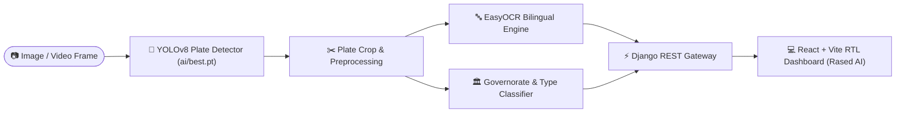

<div align="center">

# 🚘 Rased Plate AI (منظومة راصد الذكية)

### *Production-Grade Yemeni Vehicle License Plate Recognition & Governorate Classification System*

[](https://github.com/Mo-Alwosabi/Rased-Plate-AI)
[](https://github.com/Mo-Alwosabi/Rased-Plate-AI)
[](https://github.com/Mo-Alwosabi/Rased-Plate-AI)
[](https://github.com/Mo-Alwosabi/Rased-Plate-AI)
[](https://github.com/Mo-Alwosabi/Rased-Plate-AI)

*Engineered by **[Mohammed Alwosabi](https://github.com/Mo-Alwosabi)** — AI & Machine Learning Systems Engineer*

</div>

---

## 🎯 Overview

**Rased Plate AI (منظومة راصد الذكية)** is an end-to-end Computer Vision and Deep Learning platform purpose-built for **automated detection, OCR extraction, and governorate classification of Yemeni license plates** across real-world traffic, checkpoint, and parking footage.

### ✨ Core Capabilities
- **Multi-Stage CV Pipeline:** Combines **YOLOv8** (`ai/best.pt`) plate localization, perspective correction, **EasyOCR** bilingual numeral/character recognition, and **21-Governorate** classification (`config/governorates_yemen.json`).
- **Plate Type Detection:** Supports Private, Commercial, Government, Army, and Police plate formats (`config/plate_types.json`).
- **Image & Video Processing:** Handles high-resolution images and live/recorded video streams via Django REST API (`/api/v1/docs/`).
- **Cyber-Cyan & Deep Indigo RTL Interface:** Built with React + Vite featuring **Thmanyah** Arabic typography, interactive result cards, AI assistant, and developer Swagger integration.

---

## 🏗️ System Architecture



---

## 📁 Project Structure

```text
Rased-Plate-AI/
├── ai/                  # YOLOv8 weights (best.pt), detector, OCR, governorate & pipeline
├── backend/             # Django REST Framework API, rate limiting, validation & tests
├── config/              # Yemeni governorates & plate type JSON configurations
├── docs/                # Technical reports, architecture docs & user guide
├── frontend/            # React + Vite RTL UI (Cyber-Cyan theme + Thmanyah Font)
├── docker-compose.yml   # Full-stack Docker orchestration
└── README.md            # Documentation
```

---

## 🚀 Quick Start

### 1. Clone the Repository
```bash
git clone https://github.com/Mo-Alwosabi/Rased-Plate-AI.git
cd Rased-Plate-AI
```

### 2. Backend Setup (Django REST + AI Pipeline)
```bash
python -m venv .venv
.venv\Scripts\activate
pip install -r backend/requirements.txt
cd backend
python manage.py migrate
python manage.py runserver 0.0.0.0:8000
```

### 3. Frontend Setup (React + Vite)
```bash
cd frontend
npm install
npm run dev
```

Or launch the full stack with Docker:
```bash
docker-compose up --build
```

---

## 👨‍💻 Author & Contact

**Mohammed Alwosabi** — *AI & Machine Learning Systems Engineer*  
Specializing in Computer Vision, Multi-Agent Systems, and Sovereign Local AI Inference.

- 🐙 **GitHub:** [@Mo-Alwosabi](https://github.com/Mo-Alwosabi)
- 💼 **LinkedIn:** [Mohammed Alwosabi](https://www.linkedin.com/in/mohammed-al-wosabi-609a693a1)
- 📧 **Email:** `ai.mohammed.alwosabi@gmail.com`
- 📍 **Location:** Sana'a, Yemen
